<p align="center">
  <picture>
    <source media="(prefers-color-scheme: dark)" srcset="docs/media/banner-dark.jpg">
    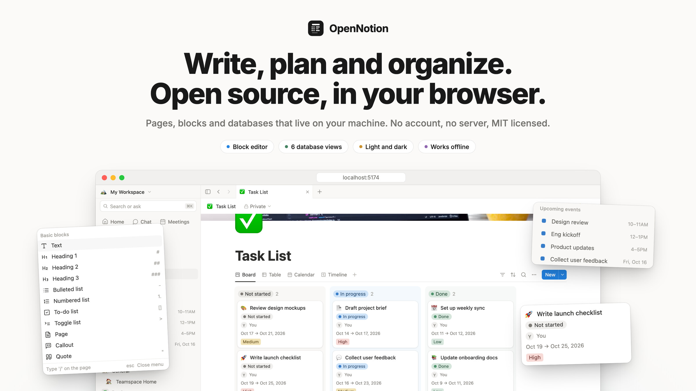
  </picture>
</p>

<p align="center">
  <b>An open source Notion alternative that runs entirely in your browser.</b><br>
  Pages, blocks and databases. No account, no server, no tracking.
</p>

<p align="center">
  <a href="https://open-notion-app.vercel.app/app/"><b>Try the live demo →</b></a>
</p>

<p align="center">
  <a href="LICENSE"></a>
  
  
  
  
  <a href="#contributing"></a>
  <a href="https://open-notion-app.vercel.app/app/"></a>
</p>

<p align="center"><sub>Unofficial project. Not affiliated with Notion Labs, Inc. See the <a href="#disclaimer">disclaimer</a>.</sub></p>

<p align="center">
  <a href="#quick-start">Quick start</a> ·
  <a href="#features">Features</a> ·
  <a href="#keyboard-shortcuts">Shortcuts</a> ·
  <a href="#how-it-works">How it works</a> ·
  <a href="#roadmap">Roadmap</a> ·
  <a href="#contributing">Contributing</a>
</p>

<br>

<p align="center">
  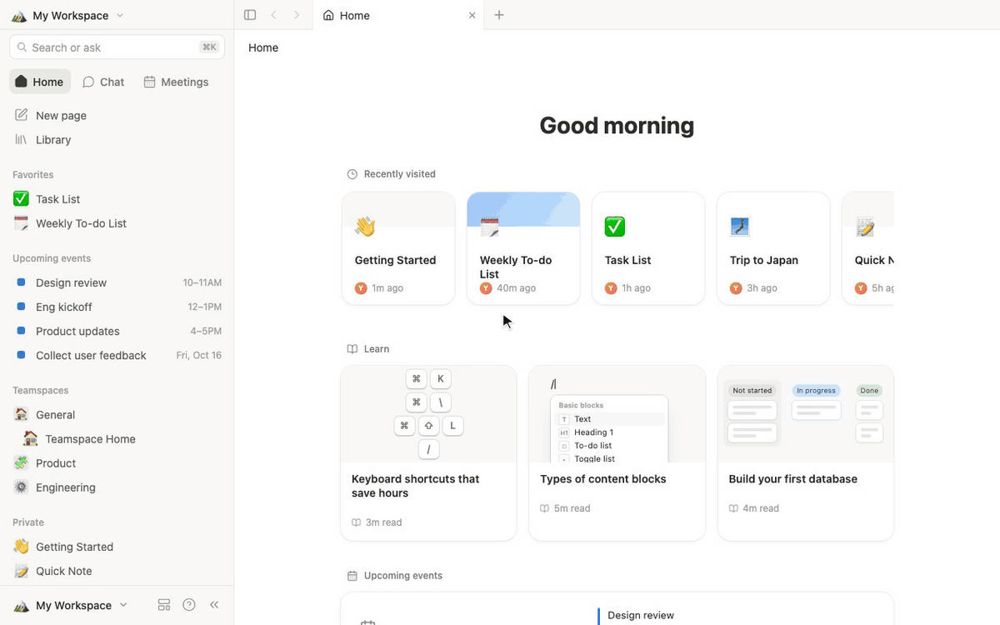
</p>

<br>

## Why OpenNotion

<table>
  <tr>
    <td width="33%" valign="top">
      <h3>🔒 Yours</h3>
      Everything lives in your browser's storage. There is no account to create, no server to trust and nothing you write leaves your machine. The app loads its scripts, fonts and images from its own host only. Export a full JSON backup whenever you want.
    </td>
    <td width="33%" valign="top">
      <h3>⚡ Instant</h3>
      No loading spinners and no network round trips. Pages open immediately, typing never lags and an open tab keeps working if your connection drops (a reload needs the network, because there is no service worker yet).
    </td>
    <td width="33%" valign="top">
      <h3>🧱 Familiar</h3>
      Blocks, the slash menu, Markdown shortcuts, drag handles, databases with six views and a side peek. If you know Notion, you already know OpenNotion.
    </td>
  </tr>
</table>

## Quick start

```bash
git clone https://github.com/Co-Messi/Open-Notion.git
cd Open-Notion
npm install
npm run dev
```

Open <http://localhost:5174/app/> for the workspace (the landing page is at <http://localhost:5174>). A starter workspace with example pages and databases is created on first launch.

Or skip the install and use the hosted demo at **[open-notion-app.vercel.app](https://open-notion-app.vercel.app/app/)**. Your data still stays in your own browser.

To host it yourself, run `npm run build` and serve the `dist/` folder from any static host (GitHub Pages, Vercel, Netlify, Cloudflare Pages or a plain web server). Each visitor gets their own private workspace in their own browser. The security headers (a strict Content-Security-Policy, `Referrer-Policy: no-referrer` and `nosniff`) live in `vercel.json`; on another host, send the same headers. `npm run preview` serves them locally.

## Features

### ✍️ Write with blocks

<table>
  <tr>
    <td width="50%">
      <picture>
        <source media="(prefers-color-scheme: dark)" srcset="docs/media/slash-dark.jpg">
        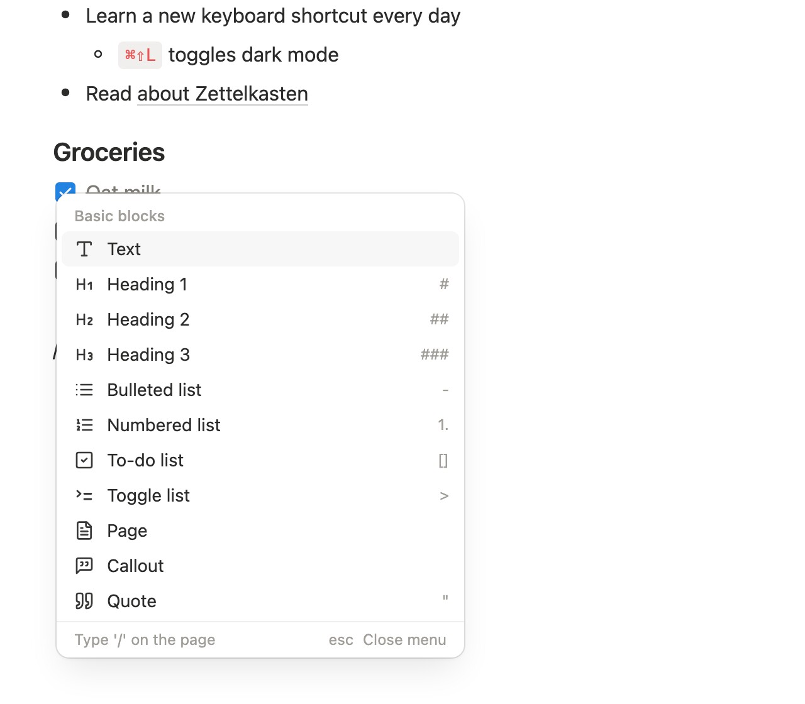
      </picture>
    </td>
    <td width="50%">
      <picture>
        <source media="(prefers-color-scheme: dark)" srcset="docs/media/toolbar-dark.jpg">
        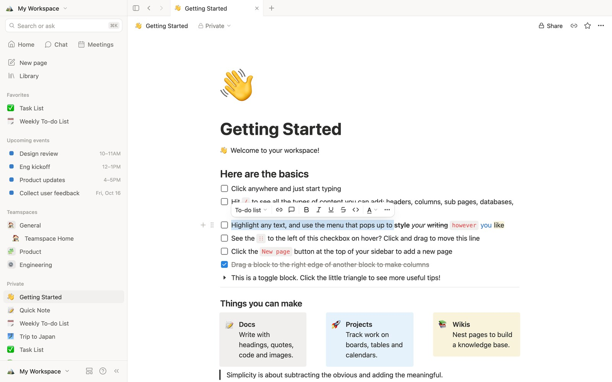
      </picture>
    </td>
  </tr>
  <tr>
    <td valign="top"><b>Slash menu.</b> Type <code>/</code> to insert any block: headings, lists, to-dos, toggles, callouts, quotes, code, images, bookmarks, tables, columns, subpages and databases.</td>
    <td valign="top"><b>Selection toolbar.</b> Bold, italic, underline, strikethrough, inline code, links, ten text colors and ten background colors, or turn the block into another type.</td>
  </tr>
</table>

- **Markdown shortcuts** as you type: `#` `##` `###` for headings, `-` for bullets, `1.` for numbers, `[]` for to-dos, `>` for toggles, `"` for quotes, ` ``` ` for code, `---` for a divider, plus `**bold**`, `*italic*`, `` `code` `` and `~strike~` inline.
- **Drag and drop** any block by its handle. Drop it beside another block to create columns.
- **Block selection** with <kbd>Esc</kbd> or a drag rectangle, then delete, duplicate, indent, move or recolor many blocks at once.
- **Undo and redo** across every edit, including structural ones like splitting and merging blocks.
- **Code blocks** with syntax highlighting for 20+ languages, **simple tables**, **images** by upload or link, and **web bookmarks**.
- **IME friendly** input, tested with Chinese pinyin.

### 🗂️ Organize with databases

<picture>
  <source media="(prefers-color-scheme: dark)" srcset="docs/media/board-dark.jpg">
  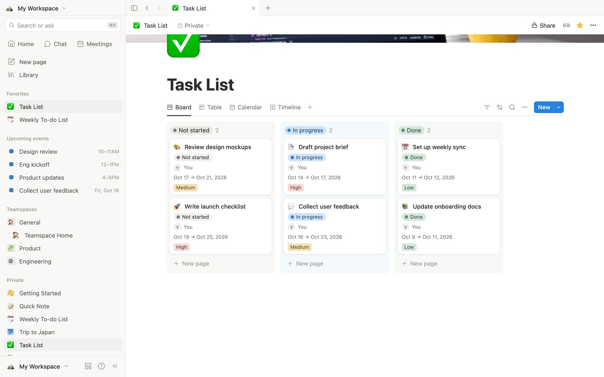
</picture>

<table>
  <tr>
    <td width="50%">
      <picture>
        <source media="(prefers-color-scheme: dark)" srcset="docs/media/table-dark.jpg">
        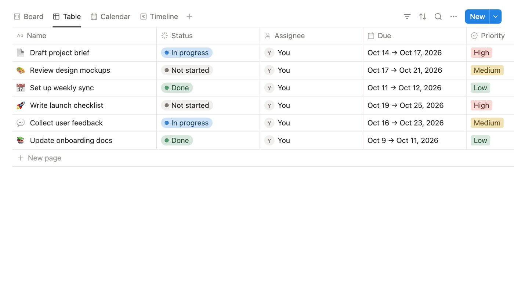
      </picture>
      <p align="center"><b>Table</b></p>
    </td>
    <td width="50%">
      <picture>
        <source media="(prefers-color-scheme: dark)" srcset="docs/media/timeline-dark.jpg">
        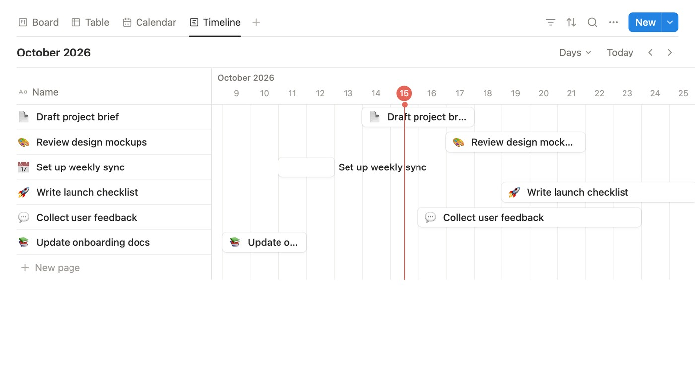
      </picture>
      <p align="center"><b>Timeline</b></p>
    </td>
  </tr>
  <tr>
    <td width="50%">
      <picture>
        <source media="(prefers-color-scheme: dark)" srcset="docs/media/calendar-dark.jpg">
        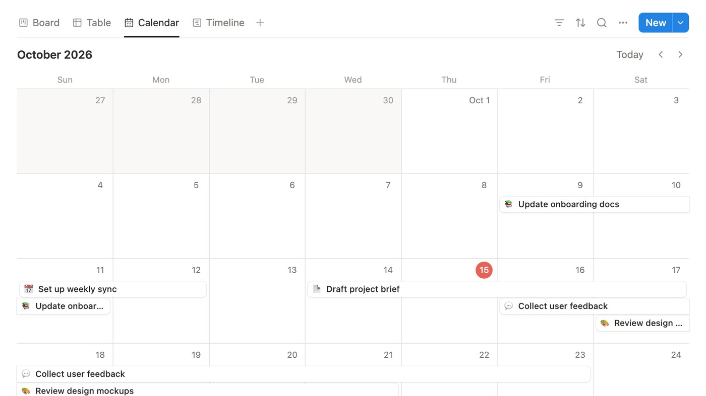
      </picture>
      <p align="center"><b>Calendar</b></p>
    </td>
    <td width="50%">
      <picture>
        <source media="(prefers-color-scheme: dark)" srcset="docs/media/gallery-dark.jpg">
        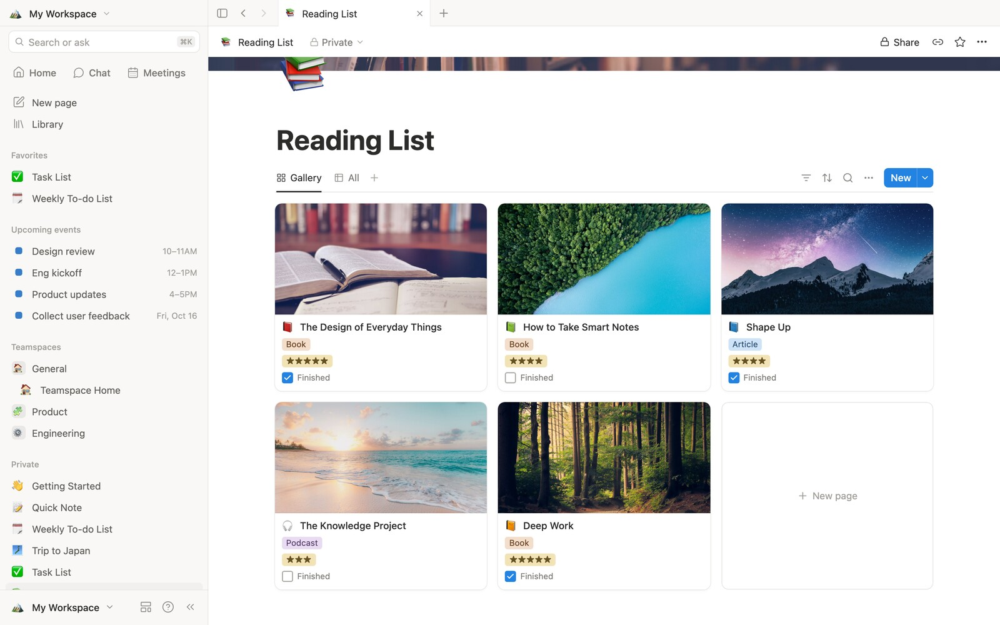
      </picture>
      <p align="center"><b>Gallery</b></p>
    </td>
  </tr>
</table>

<picture>
  <source media="(prefers-color-scheme: dark)" srcset="docs/media/peek-dark.jpg">
  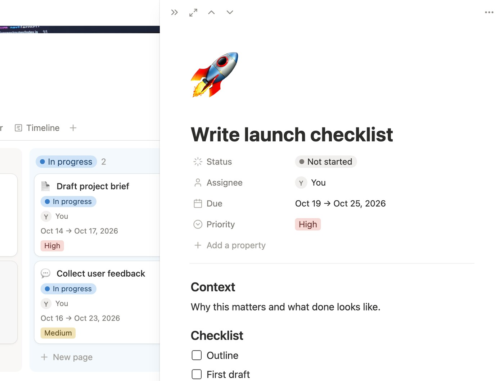
</picture>

<p align="center"><sub>Open any row in a side peek to edit its properties and content without leaving the view.</sub></p>

- **Six views**: table, board, list, gallery, calendar and timeline, each with its own filters, sorts, grouping and visible properties.
- **13 property types**: text, number, select, multi select, status, date (with time and ranges), person, checkbox, URL, email, phone, created time and last edited time.
- **Inline or full page**: drop a database into any page with `/table view`, or open it on its own.
- **Side peek** opens a row next to the view so you can edit its properties and content without losing your place.
- **Drag** cards between board columns, bars across the timeline and events across the calendar.

### 🧭 Find and navigate

<table>
  <tr>
    <td width="50%">
      <picture>
        <source media="(prefers-color-scheme: dark)" srcset="docs/media/search-dark.jpg">
        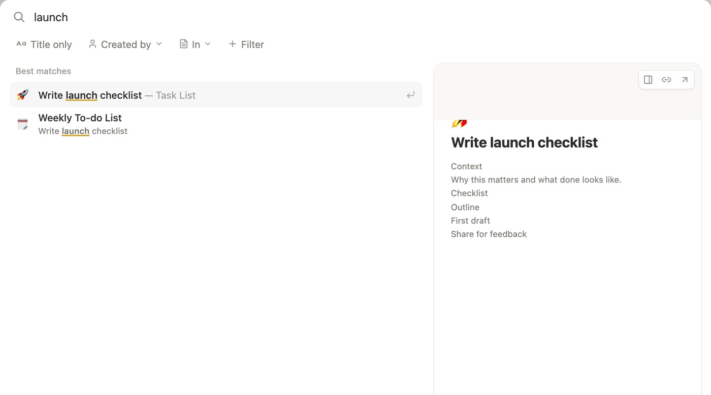
      </picture>
    </td>
    <td width="50%">
      <picture>
        <source media="(prefers-color-scheme: dark)" srcset="docs/media/home-dark.jpg">
        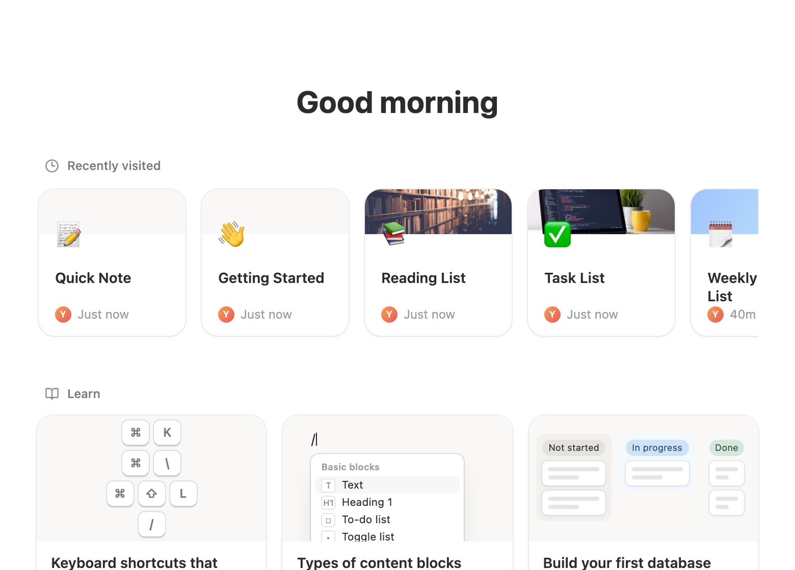
      </picture>
    </td>
  </tr>
  <tr>
    <td valign="top"><b>Search everything</b> with <kbd>⌘K</kbd>. Matches titles and page content, with a live preview of the selected page.</td>
    <td valign="top"><b>Home</b> shows recently visited pages, quick guides and upcoming events pulled from your dated database rows.</td>
  </tr>
</table>

- **Tabs** across the top, each with its own back and forward history.
- **Sidebar** with Favorites, upcoming events, teamspaces and a nested page tree you can reorder and nest by dragging.
- **Templates** for meeting notes, to-do lists, journals, specs, task trackers, reading lists, content calendars and wikis.
- **Trash** with restore, and a **Library** of every page.

### 🎨 Make it yours

<table>
  <tr>
    <td width="50%">
      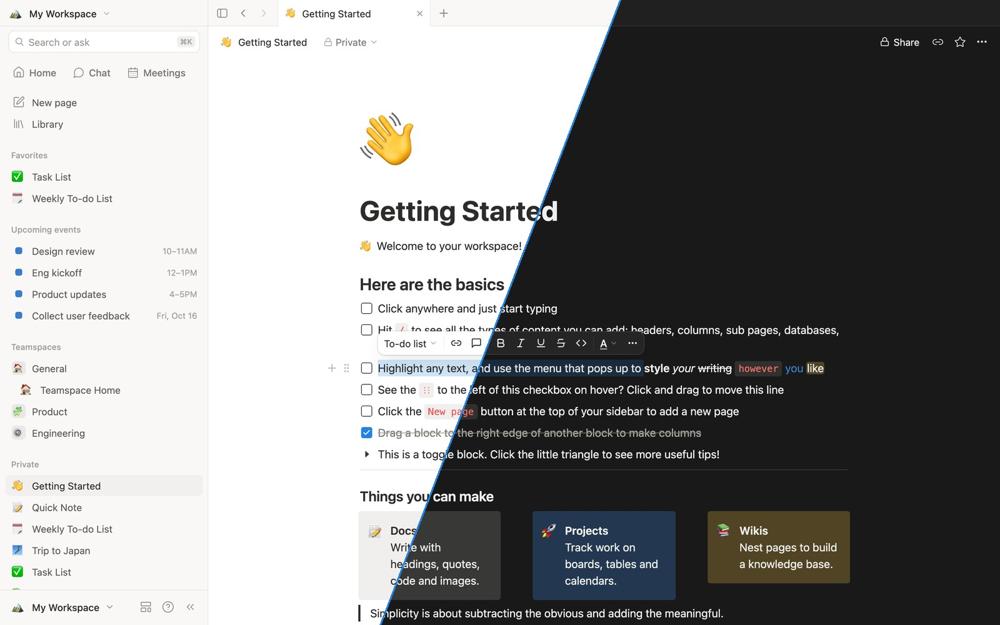
    </td>
    <td width="50%">
      <picture>
        <source media="(prefers-color-scheme: dark)" srcset="docs/media/page-dark.jpg">
        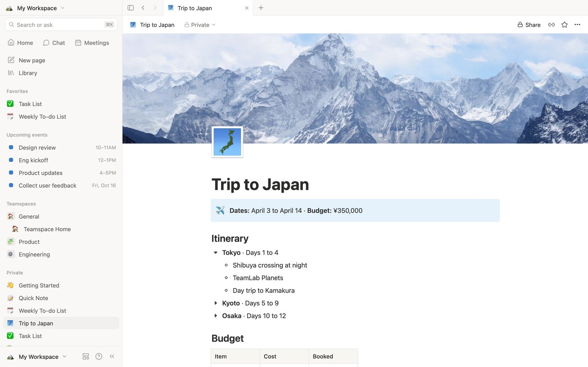
      </picture>
    </td>
  </tr>
  <tr>
    <td valign="top"><b>Light, dark or system</b> theme. Toggle any time with <kbd>⌘</kbd> <kbd>⇧</kbd> <kbd>L</kbd>.</td>
    <td valign="top"><b>Icons and covers</b> from 1,000+ emoji, gradients, bundled illustrations, uploads or any image link. Reposition covers by dragging.</td>
  </tr>
</table>

- Serif and mono page fonts, small text, full width and page lock.
- Comments on pages, favorites, duplicate, move and nested subpages.
- Import Markdown files, export any page as Markdown, and back up or restore the whole workspace as JSON.

## How OpenNotion compares

| | OpenNotion | Notion |
|---|:---:|:---:|
| Open source | ✅ MIT | ❌ |
| Price | Free | Free plan, paid tiers |
| Account required | No | Yes |
| Where your data lives | Your browser | Notion's cloud |
| Works offline | In an open tab, no offline reload yet | Partially |
| Self hosting | Any static host | ❌ |
| Real time collaboration | Not yet | ✅ |
| AI features | ❌ | ✅ |
| Integrations and API | Not yet | ✅ |

OpenNotion is for people who want the Notion way of working in a tool they fully own. If you need a team wiki with live collaboration today, Notion is the better choice.

## Keyboard shortcuts

<details>
<summary><b>General</b></summary>

| Action | Shortcut |
|---|---|
| Search | <kbd>⌘</kbd> <kbd>K</kbd> or <kbd>⌘</kbd> <kbd>P</kbd> |
| New page | <kbd>⌘</kbd> <kbd>N</kbd> |
| Toggle sidebar | <kbd>⌘</kbd> <kbd>\\</kbd> |
| Toggle dark mode | <kbd>⌘</kbd> <kbd>⇧</kbd> <kbd>L</kbd> |
| Back / forward | <kbd>⌘</kbd> <kbd>[</kbd> / <kbd>⌘</kbd> <kbd>]</kbd> |
| Settings | <kbd>⌘</kbd> <kbd>,</kbd> |
| Undo / redo | <kbd>⌘</kbd> <kbd>Z</kbd> / <kbd>⌘</kbd> <kbd>⇧</kbd> <kbd>Z</kbd> |

</details>

<details>
<summary><b>Editing</b></summary>

| Action | Shortcut |
|---|---|
| Bold / italic / underline | <kbd>⌘</kbd> <kbd>B</kbd> / <kbd>⌘</kbd> <kbd>I</kbd> / <kbd>⌘</kbd> <kbd>U</kbd> |
| Strikethrough | <kbd>⌘</kbd> <kbd>⇧</kbd> <kbd>S</kbd> |
| Inline code | <kbd>⌘</kbd> <kbd>E</kbd> |
| Add link | <kbd>⌘</kbd> <kbd>K</kbd> with text selected |
| Soft line break | <kbd>⇧</kbd> <kbd>Enter</kbd> |
| Indent / outdent | <kbd>Tab</kbd> / <kbd>⇧</kbd> <kbd>Tab</kbd> |
| Toggle to-do or open toggle | <kbd>⌘</kbd> <kbd>Enter</kbd> |
| Turn into text, heading 1 to 3 | <kbd>⌘</kbd> <kbd>⌥</kbd> <kbd>0</kbd> to <kbd>3</kbd> |
| Turn into to-do, bullet, number, toggle, code, page | <kbd>⌘</kbd> <kbd>⌥</kbd> <kbd>4</kbd> to <kbd>9</kbd> |

</details>

<details>
<summary><b>Blocks</b></summary>

| Action | Shortcut |
|---|---|
| Select the current block | <kbd>Esc</kbd> |
| Select all blocks | <kbd>⌘</kbd> <kbd>A</kbd> twice |
| Duplicate | <kbd>⌘</kbd> <kbd>D</kbd> |
| Move up / down | <kbd>⌘</kbd> <kbd>⇧</kbd> <kbd>↑</kbd> / <kbd>↓</kbd> |
| Delete selected | <kbd>Backspace</kbd> |
| Copy, cut, paste blocks | <kbd>⌘</kbd> <kbd>C</kbd> / <kbd>X</kbd> / <kbd>V</kbd> |

</details>

## How it works

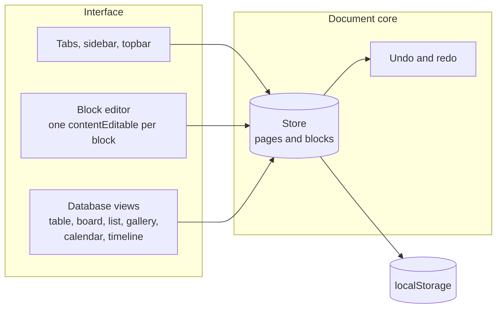

OpenNotion is a React 19 and TypeScript app built with Vite. There is no backend: a small store keeps every page and block in memory, records each change for undo, and saves to `localStorage` a moment after you stop typing.

```
src/
├── store/        Document model, actions, undo history, persistence, tabs
├── editor/       Block editor: caret logic, keys, slash menu, toolbar, drag and drop
├── database/     Database views, property editors, filters, sorts, side peek
├── components/   Sidebar, topbar, home, search, settings, templates, pickers
├── lib/          HTML sanitizing, Markdown import and export, syntax highlighting
└── styles/       Theme tokens and component styles for light and dark
```

## Roadmap

- [x] Block editor with slash menu, Markdown shortcuts and drag and drop
- [x] Databases with six views, filters, sorts and side peek
- [x] Tabs, search, templates, trash, light and dark themes
- [ ] Installable app with offline caching (PWA)
- [ ] Import a Notion workspace export (Markdown and CSV)
- [ ] Formulas, relations and rollups
- [ ] Optional sync server and real time collaboration
- [ ] Mobile layout
- [ ] Plugin API

Have an idea? [Open an issue](https://github.com/Co-Messi/Open-Notion/issues).

## Contributing

Contributions are welcome, from bug reports to new block types.

1. Fork the repo and create a branch.
2. `npm install` and `npm run dev`.
3. Make your change and run `npm run build` to type check and build.
4. Open a pull request describing what changed and why. Screenshots help for UI changes.

Please keep pull requests focused, match the existing code style, and check both light and dark themes for visual changes.

## FAQ

<details>
<summary><b>Is OpenNotion affiliated with Notion?</b></summary>

No. OpenNotion is an independent open source project and is not affiliated with, endorsed by, or sponsored by Notion Labs, Inc. See the [disclaimer](#disclaimer).
</details>

<details>
<summary><b>Where is my data stored, and how do I back it up?</b></summary>

In your browser's `localStorage`, on your device only. Use <b>Settings → Import and export</b> to download a JSON backup and restore it later or in another browser.
</details>

<details>
<summary><b>Does it contact any other servers?</b></summary>

Only the host that serves the app, for its own files. There is no analytics, error reporting or font host. An image you add by link, or an older workspace that already stores an image link (the starter workspace used to link Unsplash photos), is fetched from that image's site when the page is shown, and nothing is rewritten for you. The `Referrer-Policy: no-referrer` header stops your page address from being sent along.
</details>

<details>
<summary><b>Can I use it with my team?</b></summary>

Not yet. Each browser has its own workspace. An optional sync server for real time collaboration is on the roadmap.
</details>

<details>
<summary><b>Why are AI chat and meetings shown but not working?</b></summary>

They need a server. They are kept as placeholders so the layout feels complete, and may be wired to a self hosted backend in the future.
</details>

## Disclaimer

OpenNotion is an independent, unofficial open source project built for learning and personal use. It is not affiliated with, endorsed by, sponsored by or otherwise connected to Notion Labs, Inc. "Notion" and related names are trademarks of Notion Labs, Inc. and appear here only to describe what this project is an alternative to. This repository does not include Notion's source code, logos or artwork.

The software is provided "as is", without warranty of any kind, as stated in the [MIT License](LICENSE). The author accepts no responsibility or liability for data loss, damages or any other issue that comes from using it. Everything is stored in your own browser, so please keep your own backups.

If you represent Notion Labs, Inc. or any other rights holder and have a concern about this project, please [open an issue](https://github.com/Co-Messi/Open-Notion/issues) or contact the author. Concerns will be addressed promptly, including renaming the project or taking the repository and demo offline if requested.

## Credits

- Icons from [Lucide](https://lucide.dev) (ISC License)
- Covers in the starter workspace are illustrations generated for this project
- [Inter](https://rsms.me/inter/) by The Inter Project Authors (SIL Open Font License 1.1), served from this site
- Built with [React](https://react.dev), [TypeScript](https://www.typescriptlang.org) and [Vite](https://vite.dev)

## License

[MIT](LICENSE) © 2026 Brayden Siew

<br>

<p align="center">
  <br>
  <sub>If OpenNotion is useful to you, a star helps other people find it.</sub>
</p>
