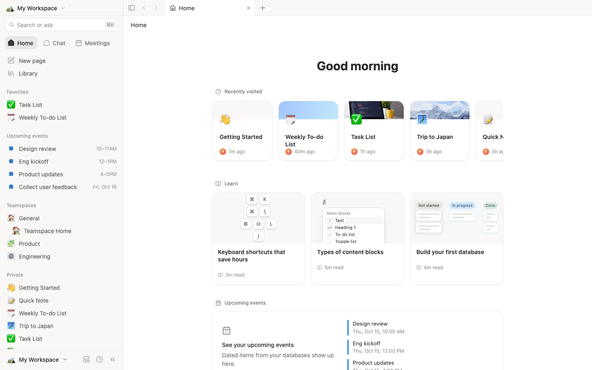
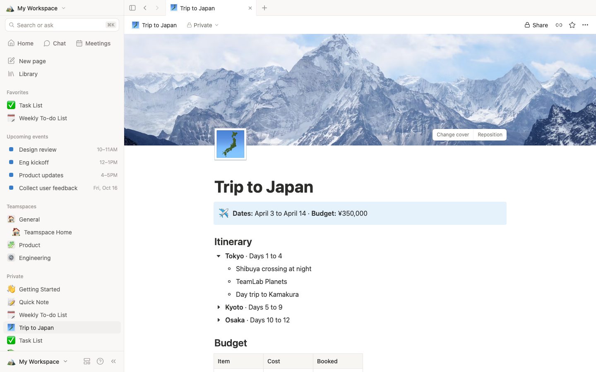
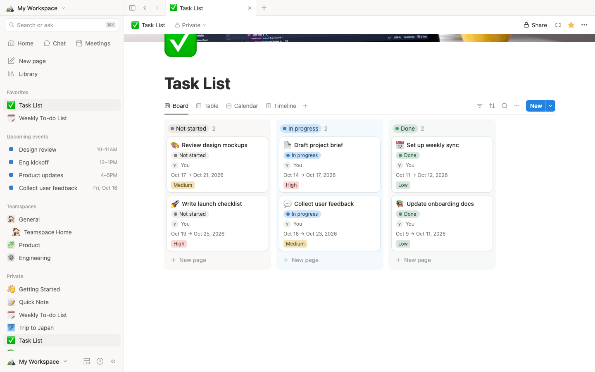
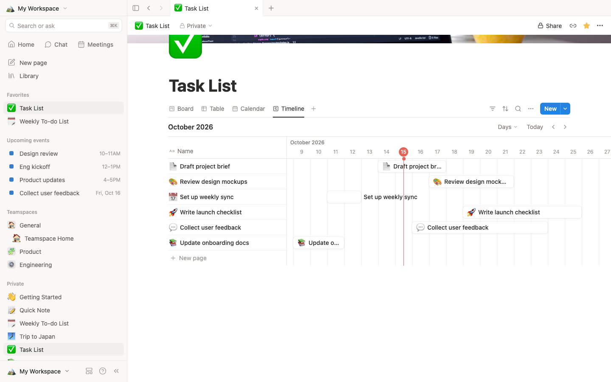
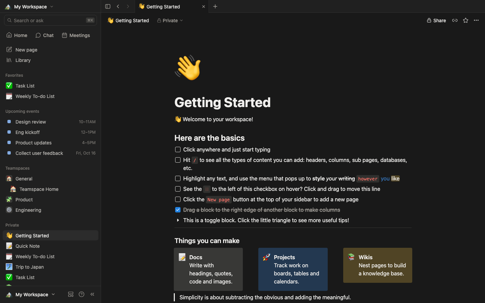

# OpenNotion

An open-source, local-first Notion alternative for the web. Pages, blocks, databases and the workspace UI you already know, running entirely in your browser with no account and no server.



> OpenNotion is an independent open-source project. It is not affiliated with, endorsed by, or sponsored by Notion Labs, Inc. "Notion" is a trademark of Notion Labs, Inc. and is used here only to describe what this project is an alternative to.

## Quick start

```bash
git clone https://github.com/Co-Messi/Open-Notion.git
cd Open-Notion
npm install
npm run dev        # http://localhost:5174
```

`npm run build` produces a static site in `dist/` that you can host anywhere.

## Features

**Workspace**
- Tab strip with back and forward history per tab
- Sidebar with search, Favorites, upcoming events, multiple teamspaces and a private page tree (drag to reorder or nest, rename, duplicate, trash)
- Home with recently visited pages, learn cards and upcoming events
- Full-text search with live preview (`⌘K` / `⌘P`)
- Templates gallery, Trash with restore, Settings with light, dark and system themes

**Editor**
- Blocks: text, headings, bulleted, numbered and to-do lists, toggles, quotes, callouts, dividers, code with syntax highlighting, images, bookmarks, simple tables, sub-pages, links to pages and multi-column layouts
- `/` command menu, Markdown shortcuts (`#`, `-`, `1.`, `[]`, `>`, `"`, ` ``` `, `---`, `**bold**`, `` `code` ``)
- Selection toolbar for bold, italic, underline, strikethrough, code, links, text and background colors
- Drag handles, drop beside a block to create columns, block selection, copy and paste of blocks
- Undo and redo; composition-aware input for IMEs (tested with Chinese pinyin)
- Page icons, covers (gradients, photos, uploads), comments, serif and mono fonts, small text, full width, page lock
- Import and export Markdown, export the whole workspace as JSON

**Databases**
- Table, board, list, gallery, calendar and timeline views
- 13 property types including select, multi-select, status, date with time and ranges, person and checkbox
- Filters, sorts, search, grouping, calculations and per-view settings
- Side peek for opening and editing rows without leaving the database

| | |
|---|---|
|  |  |
|  |  |

## Keyboard shortcuts

| Action | Shortcut |
|---|---|
| Search | `⌘K` or `⌘P` |
| New page | `⌘N` |
| Toggle sidebar | `⌘\` |
| Toggle dark mode | `⌘⇧L` |
| Undo / redo | `⌘Z` / `⌘⇧Z` |
| Select block | `Esc` |
| Duplicate block | `⌘D` |
| Move block | `⌘⇧↑` / `⌘⇧↓` |
| Turn into text / heading | `⌘⌥0` to `⌘⌥3` |
| Indent / outdent | `Tab` / `⇧Tab` |

The full list lives in Settings, Keyboard shortcuts.

## How it works

- React 19, TypeScript and Vite, no backend.
- All data is stored in `localStorage` in your browser. Export a JSON backup from Settings, Import and export.
- `src/store` holds the document model (pages and blocks), undo history and persistence.
- `src/editor` is the block editor: one `contentEditable` per block, with caret utilities, key handling, the slash menu and drag and drop.
- `src/database` contains the database views, property editors, filters and sorts.
- `src/styles/theme.css` defines every color and shadow as a CSS variable for the light and dark themes.

## Not included

These need a server and appear in the UI only as placeholders: AI chat, meeting notes and calendar connections, sharing and invites, publishing to the web, version history and real-time sync between devices.

## Credits

- Icons from [Lucide](https://lucide.dev) (ISC License)
- Starter covers from [Unsplash](https://unsplash.com) (Unsplash License)

## License

[MIT](LICENSE)
